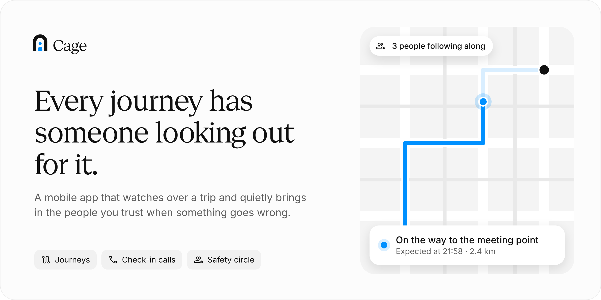
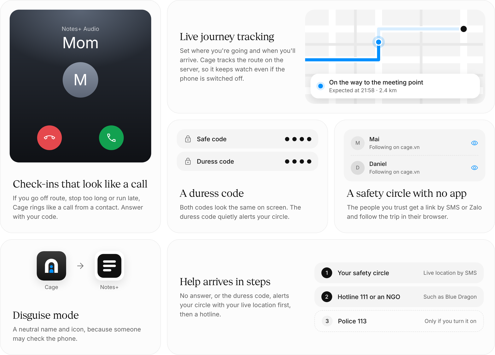

<picture>
  <source media="(prefers-color-scheme: dark)" srcset="assets/readme/hero-dark.png">
  
</picture>

# Cage

Cage is a mobile app that protects people's journeys from human trafficking. It follows a trip, checks in when something looks wrong, and quietly alerts a trusted safety circle when the user doesn't answer, then a hotline or NGO. It is built for Vietnamese users first and designed to expand to other countries.

## How it works

<picture>
  <source media="(prefers-color-scheme: dark)" srcset="assets/readme/features-dark.png">
  
</picture>

1. The user picks a **safety circle** of trusted contacts and sets a safe code and a duress PIN.
2. Before a trip, they **plan the journey**: destination and expected arrival.
3. While they travel, the circle can follow along and **SOS** is one tap away.
4. If the user goes off route, stops too long or is late, Cage **checks in**. When the screen is locked, it shows a disguised call-style alert, and the user answers with their code.
5. No answer, or the duress PIN, **alerts the circle** with live location, then a hotline (Tổng đài 111) or NGO. Police (Công an 113) are contacted only if the user allows it.
6. A server runs the timers, so Cage still raises the alarm if the phone is switched off or taken.

**Disguise mode** gives the app a neutral name and icon, because a trafficker may check the phone.

## Status

Early code. The monorepo skeleton runs: an Expo app, a Hono API on Cloudflare Workers with one Durable Object per journey, D1 with Drizzle and a TanStack Start site for the safety circle ([ADR 0001](docs/adr/0001-stack.md)). Vietnamese and English are built in ([ADR 0003](docs/adr/0003-i18n.md)).

## Getting started

```sh
bun install
bun run check                 # lint, typecheck and test every workspace
cd apps/web && bun run dev    # circle website on :3000, with the API Worker
cd apps/api && bun run dev    # API alone on :8787 (run db:migrate:local first)
cd apps/mobile && bun run dev # Expo dev server for a development build
```

## Documentation

| Doc | What's in it |
| --- | --- |
| [`docs/PRD.md`](docs/PRD.md) | Product requirements: users, threats, features, the server's job, privacy principles, MVP scope |
| [`GLOSSARY.md`](GLOSSARY.md) | Domain terms and their Vietnamese UI wording |
| [`AGENTS.md`](AGENTS.md) | Context and rules for coding agents (`CLAUDE.md` imports it) |
| [`docs/agents/`](docs/agents) | Issue tracker, triage labels and domain-doc conventions for agent skills |
| [`.agents/skills/`](.agents/skills) | Matt Pocock's engineering and productivity skills (`.claude/skills` links here) |
| [`docs/adr/`](docs/adr) | Architecture decisions, starting with the stack |
| [`assets/brand/`](assets/brand) | Logo, app icons and favicons |

Designs and the design system live on the [Doop canvas](https://doop.design/c/2v_tmcapn2). The original concept is in the [Cage concept doc](https://claude.ai/artifact/MeUFLFamAMeiHLnV32xxtS).

## Contributing

Work is tracked in [GitHub Issues](https://github.com/blackmouse572/cage/issues). Product copy is written in Vietnamese first, following the rules on the design canvas.
